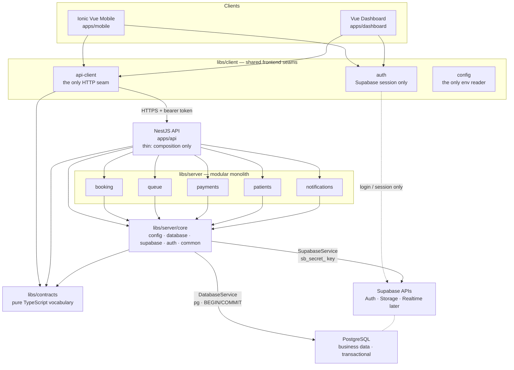

# Architecture

Clinic Operating Platform — foundation.

This document explains the shape of the system and, more importantly, _why_ it
has that shape. It describes the architecture as built, not an aspiration: at
the time of writing there is no booking, no queue and no payment logic in this
repository, by design.

---

## 1. The system at a glance



Two things in this diagram carry most of the weight.

**The dotted client line.** Clients talk to Supabase **only** to log in and hold
a session. Every business mutation goes through the API. §6 explains why.

**`server-core` has two outbound edges, not one.** Supabase's own APIs (Auth,
Storage, Realtime) go through `SupabaseService`; business data goes through
`DatabaseService` over a direct PostgreSQL connection. They reach the same
Postgres instance, but only one of them can run a multi-statement transaction.
§5 explains why that split is not optional.

---

## 2. Why Nx

Three applications and one backend share a domain vocabulary
(`AppointmentStatus`, `PaymentStatus`, `QueueStatus`). Without a monorepo that
vocabulary gets copy-pasted and drifts, and the drift is discovered in
production.

Nx was chosen over a plain pnpm workspace for one specific reason: **it can
enforce architecture, not just share code.** `@nx/enforce-module-boundaries`
turns the diagram above into a lint rule. A developer who imports
`@clinic/server-booking` from the dashboard gets a build failure, not a code
review comment six weeks later. See [dependency-rules.md](./dependency-rules.md).

The secondary benefits — one install, one lint/test/build command, task caching,
`nx graph` — are real but they are not why the choice was made.

The workspace is **integrated** style: a single root `package.json`, with
libraries resolved from source through `tsconfig.base.json` path mappings. The
alternative (package-manager workspaces with a `package.json` per library) buys
independent versioning we do not need, and costs a build step per library plus
per-library dependency bookkeeping. `pnpm-workspace.yaml` is present but
declares no packages; it exists to hold pnpm-level settings.

---

## 3. Why a modular monolith

Some clinic workflows write to more than one domain and must either all succeed
or all fail. Confirming an appointment while recording a payment intent is one
plausible example; whether the product actually works that way is a Phase 2
decision (see §3.1). What matters architecturally is that _some_ multi-domain
writes will need to be atomic.

Microservices would turn those into network calls and eventual consistency, and
would buy independent scaling and independent deployment — neither of which this
product needs, and both of which cost a great deal to operate. Reaching for
distributed transactions to solve a problem one `BEGIN` already solves is a bad
trade.

So: **one deployable NestJS application, with hard internal boundaries.**

Each business capability is a separate Nx library with its own tag. The
boundaries are enforced at lint time rather than by a network hop. Domains are
islands: `scope:booking` may depend on `scope:shared`, never on `scope:queue`.
Workflows that legitimately span domains are handled by a future orchestration
layer _above_ the domains, never by relaxing the rule — see
[cross-domain-orchestration.md](./cross-domain-orchestration.md).

If a domain ever genuinely needs to scale or deploy separately, the boundary it
would be extracted along already exists. Splitting a well-bounded module is
tractable; splitting a ball of mud is not. Starting distributed to avoid a
migration that may never be needed is paying the cost up front for an option
that is cheap to buy later.

### 3.1 The product model we are deliberately NOT assuming

It would be easy to read this system as a pipeline:

```
Booking  →  Queue  →  Payment          ← NOT the model
```

That is a product assumption, and encoding it in the architecture would be a
mistake. The neutral model is a hub with independent satellites:

```
                 Appointment
                 /         \
     Payment state          Queue entry
```

A payment may happen during booking, before arrival, at reception, or later,
depending on clinic policy. A queue entry may come from check-in, from an
appointment, from a walk-in with no appointment at all, or from a receptionist
acting manually.

Booking, Queue and Payments are therefore **separate engines**, not stages. The
rules that connect them are decided in their own design phases. The tag rules
already enforce this: no domain can reach another, so none of them can quietly
grow a dependency on a sequence we have not agreed to.

---

## 4. The role of NestJS

The API is the place where business rules live and where authorisation is
decided. Nothing else in the system is allowed to be the business layer.

**`apps/api` is deliberately thin.** It contains:

- `main.ts` — bootstrap: global prefix, URI versioning, CORS, validation,
  error shape.
- `app.module.ts` — composition: it imports modules and owns nothing.
- `health/` — the `/api/v1/health` endpoint, which reports on _this deployment_
  rather than any business capability.

That is all it will ever contain. Business logic added under `apps/api/src` is
the specific failure this structure exists to prevent: it is code that cannot be
boundary-checked, cannot be depended on selectively, and has no owner.

Conventions fixed now, so they never have to be renegotiated:

| Concern                 | Decision                                                                                                           |
| ----------------------- | ------------------------------------------------------------------------------------------------------------------ |
| Route shape             | `/api/v1/<resource>` — URI versioning, default version `1`                                                         |
| Prefix + version source | `API_PREFIX` / `API_VERSION` in `@clinic/contracts`, so client and server cannot drift                             |
| Success response        | `{ "success": true, "data": T }`                                                                                   |
| Error response          | `{ "success": false, "error": { code, message, details? } }`, produced by a global `ApiExceptionFilter`            |
| Health response         | Flat `{ "status": "ok", ... }` — probes expect a plain body, so it is the one documented exception to the envelope |
| Input validation        | Global `ValidationPipe` with `whitelist` and `forbidNonWhitelisted`                                                |
| Configuration           | `ServerConfigService` only; `process.env` is read in exactly one file                                              |

---

## 5. Supabase, PostgreSQL, and the seam between them

Supabase is **infrastructure**, not the application. But it is reached two
different ways, and the split is the single most important decision in this
layer.

### Why there are two data paths

`supabase-js` is a PostgREST client: one HTTP request per call, each its own
implicit transaction. There is no `supabase.begin()`. Any workflow that must
write to two tables atomically therefore _cannot_ be expressed with it — a
failure halfway through leaves the first write committed.

So the backend uses each tool for what it is good at:

| Path              | Service           | Client        | Used for                                                                                     |
| ----------------- | ----------------- | ------------- | -------------------------------------------------------------------------------------------- |
| **Supabase APIs** | `SupabaseService` | `supabase-js` | Auth and token verification, Storage, Realtime later                                         |
| **Business data** | `DatabaseService` | `pg`          | Appointments, queue entries, payment records, patient relationships — anything transactional |

`DatabaseService.transaction()` gives domain code a real `BEGIN`/`COMMIT` scope,
and hands the callback an `SqlExecutor` so a single domain method can run
standalone _or_ as one step of a larger, cross-domain transaction. The full
rationale, connection settings and RLS interaction are in
[database.md](./database.md).

### No ORM

Prisma, TypeORM and Drizzle each add a schema source of truth that competes with
Supabase's migrations, plus a codegen step. `supabase/migrations` remains the
**single source of truth for the schema**; `DatabaseService` only reads and
writes data. `pg` is the reference PostgreSQL driver and owns no schema. If
query ergonomics later justify a query builder, it can go _behind_ this seam
without touching domain code.

### One integration point each

`SupabaseService` is the only place that calls `createClient`; `DatabaseModule`
is the only place that constructs a connection pool. Lint enforces the second:
`pg` is a banned import for every project except `server-core`.

`SupabaseService` exposes two clients, and the distinction is a security
boundary:

- `supabase.admin` — built with the **secret key** (`sb_secret_...`).
  **Bypasses Row Level Security.** For administrative Supabase operations where
  the API has already decided the caller is allowed.
- `supabase.forUser(token)` — built with the **publishable key**
  (`sb_publishable_...`) and the user's token, so RLS applies exactly as it
  would for a direct client call.

Scattering credentials across modules would make it impossible to answer "where
can this key reach?" — the only question that matters about a key that bypasses
row-level security.

### API keys: the current Supabase model

This project uses Supabase's current key model and **not** the legacy `anon` /
`service_role` JWTs:

| Key                  | Where it lives                                                                                               | Notes                                  |
| -------------------- | ------------------------------------------------------------------------------------------------------------ | -------------------------------------- |
| `sb_secret_...`      | `SUPABASE_SECRET_KEY`, server only                                                                           | Bypasses RLS. Never bundled.           |
| `sb_publishable_...` | `VITE_SUPABASE_PUBLISHABLE_KEY` (frontends) and `SUPABASE_PUBLISHABLE_KEY` (server, for user-scoped clients) | Constrained by RLS. Safe in a browser. |

Two guards back this up rather than relying on convention:

- The API **refuses to start** if `SUPABASE_SERVICE_ROLE_KEY` is set, with a
  message telling you to rename it. A stale deployment should fail loudly, not
  look healthy.
- `libs/client/config` throws if any `VITE_`-prefixed variable holds a value
  that looks like a secret — an `sb_secret_...` key, a legacy `service_role`
  JWT, or a `postgres://` connection string — **regardless of what the variable
  is called**. A name-only blocklist would miss `VITE_ANALYTICS_TOKEN=sb_secret_…`.

---

## 6. The frontend / backend boundary

The intended flow:

```
Mobile / Dashboard
        |  Supabase Auth: login, session, refresh      -> allowed
        |  business database mutations                 -> NOT allowed
        v
   NestJS API          <- business rules, authorisation, invariants
        |
        v
   PostgreSQL          <- grants + RLS: defence in depth
```

Clients may use Supabase Auth **directly** for login, logout and session
refresh. That is what `libs/client/auth` wraps, and it is the right call:
reimplementing session management behind our own API would add a hop and a bug
surface for no gain.

Clients may **not** use Supabase as their data layer. Business mutations go
through NestJS.

This is the decision most worth defending, because Supabase makes the opposite
so easy. Writing directly from the client would mean:

- **Business rules become RLS policies.** "A booking may be cancelled up to two
  hours before its slot, unless the patient is flagged, unless the doctor is
  delayed" is a paragraph of SQL policy that no one can test or read.
- **Rules cannot be shared.** The mobile app and the dashboard would each
  reimplement them, and they would diverge.
- **Multi-step operations lose atomicity.** A client cannot open a transaction,
  so any workflow touching two tables becomes round-trips that can half-fail.
- **Nothing can be audited or notified consistently.** No single place to hook
  logging, notifications, or a webhook.

### Defence in depth, not convention

The rule is enforced at three independent levels, so no single mistake breaks
it:

1. **Build.** Lint bans `pg` from every client-side project, and
   `libs/client/config` throws if a secret-shaped value appears in any `VITE_`
   variable. A frontend cannot acquire a database connection or a privileged
   key.
2. **Network.** Frontends hold only the publishable key. Every business
   endpoint is on the API, behind CORS and a global auth guard — every route is
   protected unless it declares `@Public()`, which only `/health` does.
3. **Database.** The API connects as `clinic_api`, a least-privilege role with
   explicit per-table grants — never as the table owner or `postgres` — and
   tables will use `FORCE ROW LEVEL SECURITY` so policies apply even to the
   owner. A missing `where clinic_id = $1` in application code then fails at the
   database instead of leaking rows.

Level 3 is the one that still holds when levels 1 and 2 are wrong. RLS is not
the business layer; it is what limits the damage when the business layer has a
bug. The concrete grant and policy design is in
[database.md](./database.md#4-how-this-interacts-with-supabase-and-rls) — no
policies exist yet, because policies describe tables and there are no tables.

Frontend structure follows from this. Both apps are thin shells:

- `libs/client/api-client` — the only HTTP seam. Feature code never calls
  `fetch`.
- `libs/client/config` — the only reader of `import.meta.env`.
- `libs/client/auth` — sessions only, never data.
- Each app has one `src/app/runtime.ts` composition root that wires those three
  together, plus the session store and the typed endpoint modules. A screen
  imports `session` and an api module from there, never `createClient` or
  `fetch`.

The two apps are separate on purpose. `apps/mobile` is an Ionic + Capacitor
shell with a native navigation stack, shipped to app stores; `apps/dashboard`
is a keyboard-and-mouse web app for clinic staff. They share domain vocabulary
and the API client — not components, and not a design system, because they will
not want the same one.

---

## 7. What is deliberately absent

Listed explicitly so their absence reads as a decision rather than an oversight.
What *is* built is recorded in [status.md](status.md); this table is about what
is deliberately not.

| Not present                                      | Why                                                                                   |
| ------------------------------------------------ | ------------------------------------------------------------------------------------- |
| Payment / notification logic                     | Out of Phase 2. Empty module boundaries only.                                         |
| Payment provider                                 | No HyperPay, Moyasar, Stripe or Tap anywhere. `PaymentProvider` is the seam.          |
| Notification provider                            | No Twilio, WhatsApp Business API or FCM. `NotificationChannel` is the seam.           |
| Medical records                                  | No diagnoses, prescriptions, files or growth curves. Operational identity only.        |
| ORM                                              | Supabase migrations are the source of truth; `pg` owns no schema.                     |
| Scheduler / cron                                 | Nothing expires on a timer. Grace and no-shows are human-triggered; see docs/status.md. |
| Supabase Realtime                                | Polling instead. Realtime authorises via RLS on tables the publishable key can reach.  |
| UI design, component library, CSS system         | Only Ionic's required baseline stylesheets.                                           |
| Native Capacitor plugins                         | No camera, push, geolocation, filesystem, biometrics.                                 |
| Redis, Kafka, RabbitMQ, GraphQL, CQRS, event bus | No current problem justifies any of them.                                             |
| Caching, offline sync, realtime features         | Premature without usage data.                                                         |
| `BaseService` / `BaseRepository`                 | Abstractions with no second implementation to justify them.                           |

---

## 8. Related documents

- [database.md](./database.md) — the transactional data seam, connections, RLS
- [cross-domain-orchestration.md](./cross-domain-orchestration.md) — workflows spanning domains
- [project-structure.md](./project-structure.md) — what each app and library is for
- [dependency-rules.md](./dependency-rules.md) — the tags and the enforced rules
- [local-development.md](./local-development.md) — running it
