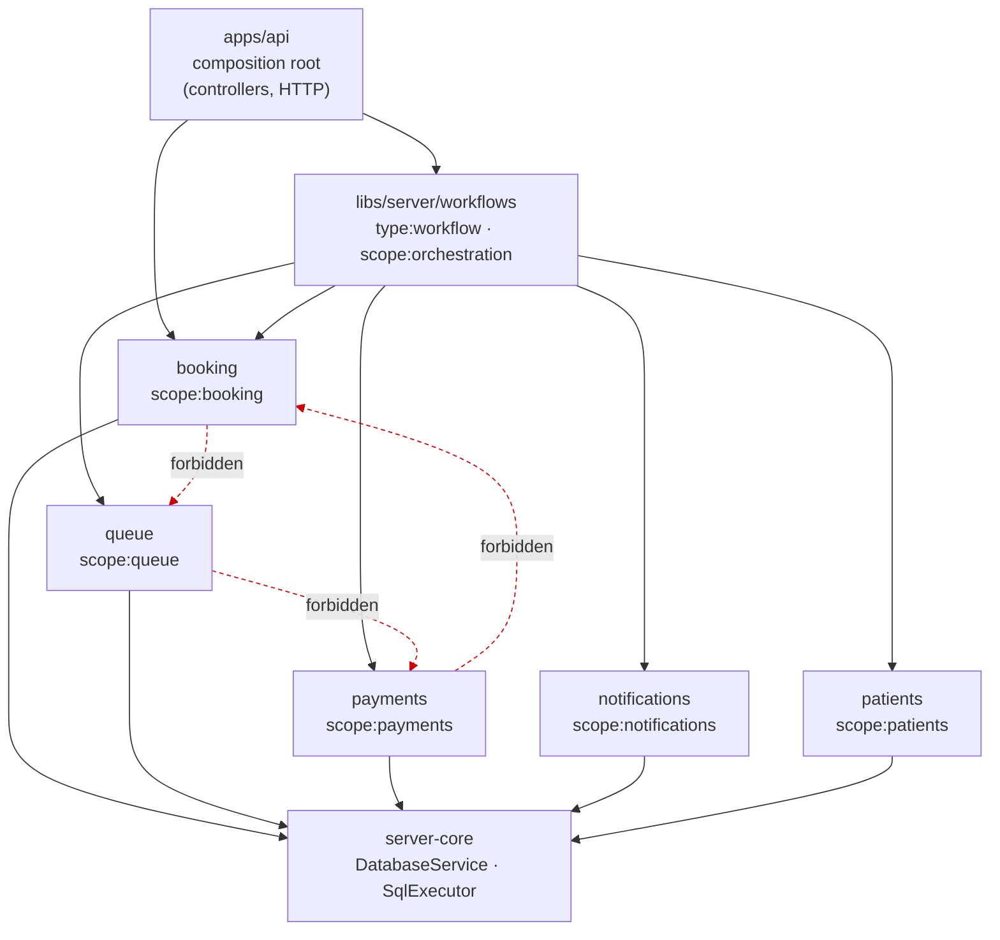

# Cross-domain orchestration

How work that touches more than one domain is coordinated — **without** letting
domains depend on each other.

The library holds cross-domain commands that must commit across Booking and
Queue, plus reads that no single domain could assemble. The staff board joins
Queue's ordering with Patients' names and Booking's expected arrivals, while
the queue completion workflows keep the linked appointment in the same atomic
state change.

The operational queue commands are intentionally distinct:

- `CompleteQueueEntryWorkflow` completes only the current entry and its linked
  appointment.
- `CallNextWorkflow` resolves an expired call and calls the next eligible entry;
  it refuses while a consultation remains `in_service`.
- `CompleteAndCallNextWorkflow` completes the current entry and then calls the
  next eligible entry in one transaction.

Queue owns ordering, grace and queue events. Booking owns appointment state.
Only this layer synchronises the two; neither domain imports the other.

---

## 1. The property we are protecting

Lint currently prevents, and must keep preventing:

```
booking  →  queue        ✗
queue    →  payments     ✗
payments →  booking      ✗
```

Each domain library is tagged `scope:<domain>` and may depend only on itself and
`scope:shared`. See [dependency-rules.md](./dependency-rules.md).

This matters because domain-to-domain imports are how a modular monolith
quietly becomes a regular monolith. They start as one reasonable call, and end
as a cycle nobody can unpick — at which point the "modules" are folders, not
boundaries.

---

## 2. What we are explicitly NOT assuming

The obvious reading of a clinic system is a pipeline:

```
Booking  →  Queue  →  Payment          ← we are NOT building this
```

That would be a product assumption baked into the architecture, and it is wrong.
The accurate model is a hub with independent satellites:

```
                 Appointment
                 /         \
     Payment state          Queue entry
   (0..n payments)        (0..1 entry, maybe)
```

Because in practice:

**Payment may happen at any point** — during booking, before arrival, at
reception on the day, or afterwards on an invoice. Which one is a _clinic
policy_, and different clinics will differ. A prepaid teleconsultation and a
walk-in vaccination have opposite payment timing.

**A queue entry may arise several ways** — from check-in against an appointment,
from a walk-in with no appointment at all, or from a receptionist inserting
someone manually. An appointment does not necessarily produce a queue entry, and
a queue entry does not necessarily come from an appointment.

So:

- Queue must work with **no** appointment (walk-ins).
- Payment must work **independently** of queue position.
- Booking must not know whether payment or queue happened.

If we wired `Booking → Queue → Payment` as a dependency chain now, every one of
those cases would become an exception to fight later. Keeping the domains
mutually unaware costs nothing today and keeps all of those futures open. The
real rules get decided in the Booking, Queue and Payments design phases.

The one shared thing that _is_ safe to fix now is vocabulary —
`AppointmentStatus`, `QueueStatus`, `PaymentStatus` in `@clinic/contracts` —
because naming a state is not the same as asserting what causes it.

---

## 3. The pattern: an orchestration layer above the domains

Dependencies point **inward, one level**. Domains never see each other; a
workflow sees several domains.



A workflow is a plain injectable service that calls domain services and owns the
transaction:

```ts
// libs/server/workflows/src/lib/book-appointment.workflow.ts   (illustrative)
@Injectable()
export class BookAppointmentWorkflow {
  constructor(
    private readonly database: DatabaseService,
    private readonly appointments: AppointmentService, // @clinic/server-booking
    private readonly payments: PaymentService, // @clinic/server-payments
    private readonly notifications: NotificationService, // @clinic/server-notifications
  ) {}

  async execute(command: BookAppointmentCommand): Promise<BookingResult> {
    // One transaction across two domains. Each domain method takes the
    // executor, so both statements share a connection and commit together.
    const result = await this.database.transaction(async (tx) => {
      const appointment = await this.appointments.book(command, tx);

      // Whether a payment record is created here at all is clinic policy,
      // decided in the Payments design phase - not a structural assumption.
      await this.payments.recordIntent(appointment.id, command.payment, tx);

      return appointment;
    });

    // Deliberately AFTER commit: side effects that leave the system must not
    // sit inside a transaction, and must not be able to roll one back.
    await this.notifications.appointmentBooked(result.id);

    return result;
  }
}
```

Three things that make this work:

1. **Every domain method takes an optional `SqlExecutor`.** That is the contract
   that lets an orchestrator make several domains share one transaction. See
   [database.md](./database.md#the-sqlexecutor-interface-is-the-important-part).
2. **Domains expose intent-shaped services through their public `index.ts`.**
   The workflow depends on `AppointmentService`, not on booking's internals.
3. **External side effects happen after commit.** Never `await` a payment
   provider or a WhatsApp send inside a transaction: it holds locks for the
   duration of someone else's outage, and a failure there would roll back a
   booking that was otherwise valid.

---

## 4. The library, and the layer it needs

`libs/server/workflows` is tagged
`type:workflow,platform:server,scope:orchestration`. Nothing goes in it that a
single domain could do alone.

A controller in `apps/api` calling a single domain service is correct and needs
no workflow. The application stays primarily a composition root: controllers,
HTTP concerns, and wiring — no business rules.

It was generated with:

```bash
pnpm nx g @nx/nest:library libs/server/workflows \
  --name=server-workflows --importPath=@clinic/server-workflows \
  --unitTestRunner=jest --strict --useProjectJson \
  --tags="type:workflow,platform:server,scope:orchestration"
```

Two rules in `depConstraints` make that tagging work.

### 4.1 Why `type:workflow` exists

This document used to say to tag the library `type:feature`. **That cannot
work.** Nx constraints _intersect_ — a project must satisfy every rule whose
`sourceTag` it matches — and the `type:feature` rule permits only
`type:data-access` / `type:util` / `type:contract`. A `type:feature` workflows
library is therefore forbidden from importing `@clinic/server-booking` (also
`type:feature`), no matter what the scope rule says.

Widening `type:feature` to permit `type:feature` would "fix" that by letting
every domain import every other domain — deleting the boundary this document
exists to defend. So orchestration gets its own layer instead:

```js
{
  // Cross-domain orchestration sits one layer ABOVE the domains.
  sourceTag: 'type:workflow',
  onlyDependOnLibsWithTags: [
    'type:feature', 'type:data-access', 'type:util', 'type:contract',
  ],
  bannedExternalImports: ['pg'],
},
```

…and `type:app` gains `type:workflow` so the API can compose it. The layering
is now `app → workflow → feature → data-access → util → contract`.

### 4.2 The scope rule

In the scope section:

```js
{
  // The only projects allowed to depend on several domains at once.
  // Domains still cannot see each other; orchestration flows one way.
  sourceTag: 'scope:orchestration',
  onlyDependOnLibsWithTags: [
    'scope:booking',
    'scope:queue',
    'scope:payments',
    'scope:patients',
    'scope:notifications',
    'scope:shared',
  ],
},
```

No domain gains a new permission. The asymmetry is the whole point: **one**
project may know about many domains, and it is the one whose job that is.

Both rules are verified by deliberate violation, per
[dependency-rules.md](./dependency-rules.md):

| Probe                                         | Expected | Why                              |
| --------------------------------------------- | -------- | -------------------------------- |
| `server-booking` → `@clinic/server-queue`     | blocked  | domains stay islands             |
| `server-booking` → `@clinic/server-workflows` | blocked  | orchestration is one-directional |
| `server-booking` → `@clinic/server-clinic`    | allowed  | `scope:shared` is reachable      |
| `server-workflows` → `@clinic/server-booking` | allowed  | the whole point of the layer     |

Guard rails for that library:

- Workflows orchestrate; they do not contain domain rules. A rule about what
  makes a booking valid belongs in `booking`, not here.
- No domain may ever depend on `scope:orchestration` — the rule above is
  one-directional, and nothing lists `scope:orchestration` as a permitted
  dependency.
- If a workflow needs a domain to expose something new, add it to that domain's
  public interface deliberately. Do not reach past `index.ts`.

---

## 5. Alternatives considered

| Option                                    | Why not now                                                                                                                                                                                                                                                                                               |
| ----------------------------------------- | --------------------------------------------------------------------------------------------------------------------------------------------------------------------------------------------------------------------------------------------------------------------------------------------------------- |
| Let domains import each other directly    | Destroys the boundary; produces cycles. This is the failure mode being prevented.                                                                                                                                                                                                                         |
| In-process event bus / domain events      | Real option later for _decoupling side effects_, but it does not solve atomicity — a handler runs after the fact and can fail independently. Adds indirection that makes a simple workflow harder to read, and debugging becomes tracing. Revisit when there are many independent reactions to one event. |
| Orchestrate inside `apps/api` controllers | Puts business sequencing in the composition root, untestable without HTTP, and unavailable to non-HTTP entry points (cron, webhooks). Acceptable only for a single-domain call.                                                                                                                           |
| CQRS / a command bus                      | Solves a problem we do not have. Revisit only if read and write models genuinely diverge.                                                                                                                                                                                                                 |
| Saga / process manager                    | Only needed for long-running workflows spanning services that cannot share a transaction. A modular monolith on one database can just use `BEGIN`.                                                                                                                                                        |

---

## 6. Related documents

- [architecture.md](./architecture.md) — why a modular monolith
- [database.md](./database.md) — transactions and the `SqlExecutor` contract
- [dependency-rules.md](./dependency-rules.md) — the enforced tag rules
